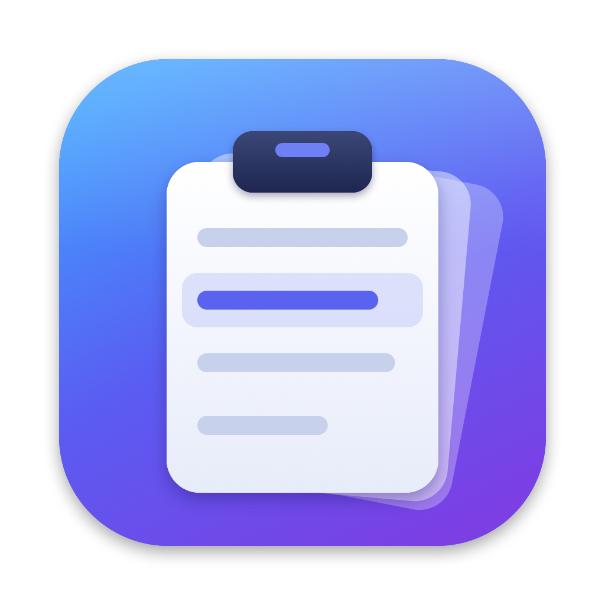

# Maclip

Maclip is a free, open-source clipboard history app for the Mac menu bar, like Windows' clipboard history (Win+V). It records the text and images you copy. A keyboard shortcut opens a searchable list, and choosing an item pastes it into the app you were typing in.



- Runs in the menu bar (clipboard icon). It has no Dock icon.
- Stores copied text: single words, sentences and multi-line text. It skips blank text and an immediate repeat of the newest item. Copying something that is already further down the list moves it back to the top.
- Stores copied images, such as screenshots copied to the clipboard and "Copy Image" in a browser. They show as thumbnails, and choosing one pastes the image.
- Keeps up to 100 unpinned items, text and images together. Pinned items are always kept.
- Saves the history so it survives restarts. Maclip is sandboxed, so the files live in its container: `~/Library/Containers/com.clipboard.Maclip/Data/Library/Application Support/Maclip/`. That folder holds `history.json` plus the images as PNG files, readable only by you.
- Ignores items that password managers mark as concealed or transient (`org.nspasteboard.ConcealedType` and similar).
- On first launch, a welcome window explains the app and the auto-paste permission. Reopen it from the menu bar icon → **Welcome & Setup…**.
- **About Maclip** (top of the menu bar menu) shows the version and a short description.

## Preferences

Open **Preferences…** from the menu bar icon (or open Maclip again while it's running):

| Setting | Options |
| --- | --- |
| Keep history for | Forever (default), 1 day, 7, 30, 90 days, 1 year: unpinned items last copied longer ago are removed |
| Items to keep | 25, 50, 100 (default), 200, 500, 1000 unpinned items; lowering it removes the oldest straight away |
| Theme | System (default), Light, Dark: applies to the panel and Maclip's windows |
| Open Maclip shortcut | Click the shortcut, then press any key with ⌘, ⌃ or ⌥ (Esc cancels); **Reset** returns to ⇧⌘V |
| Launch Maclip at login | On/off |
| Auto-paste | Shows whether the Accessibility permission is granted, with a button to enable it |

**Clear History…** deletes everything except pinned items. Pinned items never expire and don't count toward the item limit. The list of keys you can use inside the panel is shown under **Shortcuts in the Maclip panel**.

## Shortcut

The default is **⇧⌘V (Cmd+Shift+V)**, the closest Mac equivalent of Win+V.

Some apps (Pages, Mail, Notes and others) use ⇧⌘V for "Paste and Match Style". While Maclip is running it takes over that shortcut everywhere. If you'd rather keep it, record a different shortcut in **Preferences → Keyboard Shortcuts**.

The panel opens next to the mouse pointer, with the search bar at the top already focused. Just start typing to filter:

| Key | Action |
| --- | --- |
| type | search ("image" finds all images); the ⓧ button clears it |
| ↑ / ↓ | move the selection |
| ↩ or click | paste the item into the previous app |
| ⌥↩ | copy only (don't paste) |
| ⌘1 … ⌘9 | paste item 1–9 |
| ⌘P or pin icon | pin or unpin |
| ⌘⌫ or trash icon | delete the item |
| Clear all | delete everything except pinned items |
| esc | clear the search; press again to close |
| click elsewhere | close |

Pinned items are listed first. Within each group, the newest item comes first.

## Build and run

You need Xcode with Swift 5.9 or later, on macOS 14 or later.

```bash
git clone https://github.com/dCloser/Maclip.git
cd Maclip && ./build.sh
open build/Maclip.app
```

`./build.sh` creates `build/Maclip.app`: sandboxed, with the icon compiled in, and signed ad-hoc, which is fine for your own Mac. `swift test` runs the unit tests for the history model.

Debug builds can render the main windows to PNG files, in light and dark, using sample data. This is useful for checking layouts and as a starting point for App Store screenshots:
```bash
swift build && "$(swift build --show-bin-path)/Maclip" --snapshot ~/Desktop/maclip-snapshots
```

To sign with your Developer ID instead, which keeps the Accessibility permission across rebuilds:

```bash
SIGN_IDENTITY="Developer ID Application: Your Name (TEAMID)" ./build.sh
```

The script refuses a revoked certificate. macOS kills an app signed with one, and may move it to the Trash.

To change the icon, edit `Support/make-icon.swift`, run `swift Support/make-icon.swift`, then rebuild.

## Auto-paste permission (Accessibility)

Recording copies and opening the panel work without any permission. To *paste* the chosen item into the other app, Maclip presses ⌘V for you, and macOS only allows that for apps you approve:

1. In the welcome window, click **Enable Auto-Paste…**. You can also use the menu bar icon → **Enable Auto-paste…**, or the **Grant…** link in the panel.
2. In **System Settings → Privacy & Security → Accessibility**, turn on **Maclip**. If it isn't listed, click **+** and add the copy of Maclip you run.
3. The welcome window updates to "Auto-paste is enabled", and the menu shows "✓ Auto-paste enabled".

Without the permission, choosing an item puts it on the clipboard and beeps, and you press ⌘V yourself.

macOS ties this permission to the app's location and signature:
- A copy installed in `/Applications` needs its own entry.
- Each ad-hoc rebuild needs a fresh entry. Remove the old one with **−** and add the app again.

### Clipboard privacy (macOS 15.4 and later)

Newer macOS versions can ask before an app reads the clipboard in the background ("Paste from Other Apps"). If macOS asks about Maclip, choose **Allow**. If the menu shows "⚠︎ Clipboard reading restricted", set Maclip to **Allow** in **System Settings → Privacy & Security**. Otherwise nothing gets recorded.

## Making a DMG (direct download)

```bash
SIGN_IDENTITY="Developer ID Application: Your Name (TEAMID)" NOTARY_PROFILE=notary ./make-dmg.sh
```

This rebuilds and signs the app with your Developer ID and wraps it in `build/Maclip.dmg`, with an **Applications** shortcut for drag-to-install. It then has Apple notarize the DMG and staples the result, so it opens on any Mac without warnings. A team's first notarization can take up to an hour.

`./make-dmg.sh` without variables packages the current local build, unsigned for distribution. Raise `CFBundleShortVersionString` in `Support/Info.plist` for each release.

The notarization login was stored once with:
```bash
xcrun notarytool store-credentials notary --apple-id <developer Apple ID> --team-id TEAMID
```

## Mac App Store

### One-time setup (developer account)

1. **Certificates:** in Xcode → Settings → Accounts → your team → **Manage Certificates…**, add **Apple Distribution** and **Mac Installer Distribution**.
2. **App ID:** at developer.apple.com → Certificates, Identifiers & Profiles → **Identifiers**, add an App ID (macOS) with bundle ID `com.clipboard.Maclip`. No extra capabilities are needed.
3. **Provisioning profile:** under **Profiles**, add a **Mac App Store Connect** distribution profile for that App ID. Download it and save it as `Support/Maclip_App_Store.provisionprofile`, or pass its path with `PROFILE=…`.
4. **App Store Connect:** at appstoreconnect.apple.com → Apps → **+** → New macOS App. Pick bundle ID `com.clipboard.Maclip`, name **Maclip** (it must be unused on the store), and SKU `maclip`.

### Each release

```bash
BUILD_NUMBER=1 ./make-appstore.sh
```

- This builds a separate App Store-signed copy in `build/appstore/` and packages it as `build/Maclip.pkg`. Your local `build/Maclip.app` is left alone.
- `BUILD_NUMBER` must go up with every upload, even for the same version.
- Upload `build/Maclip.pkg` with Apple's free **Transporter** app (Mac App Store). Then pick the build in App Store Connect and **Submit for Review**.

### Listing checklist

- Screenshots: at least one, 2880×1800 or 1440×900.
- Description and keywords.
- Support URL and privacy policy URL. A simple page saying all clipboard data stays on your Mac and nothing is collected is enough.
- App Privacy: **Data Not Collected**.
- Category: Productivity. Age rating and price.
- Review notes, so the reviewer understands the Accessibility request: "Maclip is a clipboard history app. Press ⇧⌘V to open it. Accessibility permission is optional and only used to send ⌘V to paste the chosen item into the frontmost app; without it, items are copied and the user pastes manually."

## Project layout

```
Package.swift
Sources/MaclipCore/HistoryStore.swift      history model: text + image items, dedupe, cap, pins, search, persistence
Sources/Maclip/main.swift                  app entry (menu bar app)
Sources/Maclip/AppDelegate.swift           menu bar menu, wiring, launch at login
Sources/Maclip/WelcomeWindow.swift         first-launch welcome / setup window
Sources/Maclip/Preferences.swift           settings model (history length, item limit, theme, shortcut)
Sources/Maclip/PreferencesWindow.swift     Preferences window and shortcut recorder
Sources/Maclip/About.swift                 About Maclip panel
Sources/Maclip/Snapshots.swift             debug-only --snapshot mode
Sources/Maclip/PasteboardWatcher.swift     polls NSPasteboard.changeCount, reads text or PNG/TIFF images
Sources/Maclip/HotKey.swift                KeyCombo + global shortcut via Carbon RegisterEventHotKey
Sources/Maclip/Paster.swift                paste permission (CGRequestPostEventAccess) and synthetic ⌘V
Sources/Maclip/HistoryPanel.swift          floating non-activating panel + keyboard handling
Sources/Maclip/HistoryView.swift           SwiftUI list UI with image thumbnails
Tests/MaclipCoreTests/                     unit tests for the model
Support/Info.plist                         bundle info (com.clipboard.Maclip, menu bar only, App Store keys)
Support/Maclip.entitlements                App Sandbox
Support/container-migration.plist          moves history from the old "ClipboardHistory" builds into the sandbox
Support/make-icon.swift                    draws the icon → Support/Assets.xcassets, Support/AppIcon-1024.png
build.sh                                   builds and signs build/Maclip.app
make-dmg.sh                                packages build/Maclip.dmg (optionally notarized)
make-appstore.sh                           builds build/Maclip.pkg for App Store upload
```

There are no third-party dependencies.

## Notes and limitations

- **Screenshots:** ⇧⌘4 / ⇧⌘3 / ⇧⌘5 save the screenshot as a file on the Desktop and don't touch the clipboard. Add **Control** (⌃⇧⌘4, ⌃⇧⌘3) to copy the screenshot instead, so it lands in the history. You can also set ⇧⌘5 → Options → Save to → **Clipboard**.
- Copying a *file* in Finder is recorded as its file name (text), not as the file.
- When an app puts both text and a picture on the clipboard (e.g. copying cells in Excel), the text is kept.
- Text longer than 1,000,000 characters and images larger than 25 MB (as PNG) are not recorded.
- History is stored as plain JSON and PNG files inside Maclip's container. When Maclip is signed with a real certificate, macOS stops other apps from reading that container. Use **Clear all** or Preferences → **Clear History…** to wipe it.
- The synthetic paste sends the key at the physical "V" position. On non-QWERTY layouts where ⌘V lives elsewhere, use ⌥↩ (copy only) and paste yourself.

## License

Maclip is released under the [MIT License](LICENSE).
